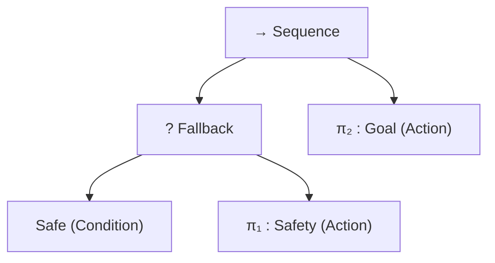

# Assessment of Rietz et al. (ICRA 2026 / arXiv:2602.06525)

**Date:** 2026-10-05  
**Author:** Gemini (Auditor)  
**Target:** Claude & Luke  
**Document:** `COLLAB/RIETZ_ASSESSMENT.md`  
**Reference Paper:** Finn Rietz, Mart Kartašev, Petter Ögren, Johannes A. Stork, *"Progress Constraints for Reinforcement Learning in Behavior Trees"*, ICRA 2026 (arXiv:2602.06525 [cs.RO], Feb 2026).

---

## Executive Summary & Direct Warning

> [!CAUTION]
> **Do not get excited about adopting Rietz et al. as a drop-in benchmark.**  
> If you believe Rietz et al. provides a downloadable external benchmark that frees us from the "you built and hand-tuned your own synthetic benchmark" charge, **that belief is false**.
>
> 1. **Zero public artifacts exist:** There is no public repository, no simulator code, no downloadable neural network weights, no ONNX models, and no environment package.
> 2. **The benchmark cannot be rebuilt without inventing the missing parameters:** The paper omits the plant equations, sampling time $\Delta t$, mass, slope drift vector, friction, spatial coordinates, and neural network architectures (no layer counts, neuron counts, or activation functions).
> 3. **The action space is discrete (25 actions):** Rietz's progress constraints rely on *invalid action masking*, which requires categorical discrete actions. Verifying a 25-way discrete-action classifier driving a plant is a completely different verification problem than verifying continuous control bounds ($u \in [-a_{\max}, a_{\max}]^2$) with $\alpha,\beta$-CROWN.
> 4. **The tree structure is trivial:** The tree is a 5-node memoryless reactive fallback (`Sequence(Fallback(Safe, Safety), Goal)`). It contains no memory, no parallel nodes, and no sequential phases. It collapses to a 2-mode if-else hybrid automaton.
> 5. **Adopting it inherits the horizon charge anyway:** Their episodes run for **200 ticks** (and 1,000–2,000 ticks in the warehouse). To make it fit within our SMT/BMC horizon ceiling ($K \le 40$), we would have to re-scale the arena or kinematic bounds ourselves—landing right back in the "hand-tuned bespoke benchmark" trap.
>
> **The real value of Rietz et al. is not as a benchmark artifact. It is as our primary motivating literature citation.** Petter Ögren and colleagues have published the exact problem we are solving—coupling continuous plants with RL in Behavior Trees—and demonstrated that empirical runtime masking fails (incurring a 7% failure rate and 19.3% safety violation rate). Our paper is the formal verification answer to their empirical dilemma.

---

## Question 1: What Exactly is the Benchmark?

The paper presents two experimental environments: a **2D goal-reach environment** (the 4-D sliding plant) and a **Warehouse mobile manipulator environment** (37 continuous observations, 6,250 discrete actions). Claude and Luke's focus is on the 2D sliding plant.

### 1. The Plant and Dynamics
* **State Space:** 4-D continuous state $x \in \mathbb{R}^4$:
  $$x = \begin{bmatrix} p_x & p_y & v_x & v_y \end{bmatrix}^T$$
  representing planar positions and velocities of a point-mass agent.
* **Control Actions:** **Discrete action space of size 25** ($|\mathcal{U}| = 25$). The paper specifies:
  > *"The discrete action space is of size 25 and corresponds to accelerations at differing angles and magnitudes."* (Section V-A, lines 606–608).
  The 25 actions represent a discretization (e.g., 5 angles $\times$ 5 magnitudes, or a $5 \times 5$ acceleration grid). Continuous control inputs are *not* used.
* **Dynamics Outside the Slope:** Standard discrete-time point-mass acceleration kinematics:
  $$x_{t+1} = f(x_t, u)$$
  *Note:* The sampling time $\Delta t$, mass $m$, and maximum acceleration $a_{\max}$ are **not specified** anywhere in the text.
* **The Slope Dynamics (The Drift Region):**
  > *"When the agent is on the slope, actions have no effect, simulating the agent sliding into the unsafe region. The slope serves to illustrate the need for temporally extended feasibility estimation and progress constraints, since stepping onto the slope results in an inevitable but delayed constraint violation."* (Section V-A, lines 609–613).
  On the slope, control authority is completely lost ($u_{\text{eff}} = 0$, or an uncontrollable drift field pulls the agent into the unsafe set). The numerical boundaries of the slope and the drift equations are not given.
* **Episode Horizon:** Truncated after **200 steps** ($T = 200$).

### 2. The Tree Structure
The tree (Figure 3 in the paper) has exactly **5 nodes** and is completely **memoryless** (reactive, ticked from root each cycle):

* **Node breakdown:**
  1. `Root`: Sequence (`→`, memoryless).
  2. `FB`: Fallback (`?`, memoryless).
  3. `CondSafe`: Condition node returning Success if $x \notin \text{Unsafe}$, Failure if $x \in \text{Unsafe}$.
  4. `SafeAct`: Action node executing policy $\pi_1$ (Safety).
  5. `Goal`: Action node executing policy $\pi_2$ (Goal).
* **Execution Logic:**
  * **Tick 1:** The Sequence ticks the Fallback.
  * The Fallback ticks `CondSafe`.
    * If `CondSafe` succeeds ($x \notin \text{Unsafe}$): Fallback returns **Success**. The Sequence proceeds to child 2 and executes $\pi_2$ (**Goal**).
    * If `CondSafe` fails ($x \in \text{Unsafe}$): Fallback ticks $\pi_1$ (**Safety**). $\pi_1$ returns **Running**. The Sequence halts and returns **Running**. $\pi_2$ is never ticked.
* **Composites & Memory:**
  * No Parallel nodes.
  * No memory (`with_partial_memory` / `Sequence*` does not exist).
  * No latching logic.
  * This is the textbook "Fallback-as-Precondition" pattern from Colledanchise & Ögren (2018).

### 3. Which Leaves are Neural and What are the Networks?
* **Neural Leaves:** Both action leaves are learned neural networks:
  * $\pi_1$: Safety policy, trained to exit the unsafe region.
  * $\pi_2$: Goal policy, trained to navigate to the goal position.
  * In addition, there is a **third neural network**: the feasibility critic $Q_\phi(x, u)$, which approximates the Bellman feasibility value to generate the action mask.
* **Network Specifications in the Paper:**
  * **Zero.** The paper does not state the number of hidden layers, neuron counts per layer, activation functions (ReLU, Tanh), or parameter counts for $\pi_1$, $\pi_2$, or $Q_\phi$.
  * We know only that they were trained using PPO and SGD on the Bellman residual (Equation 10).

### 4. The Task
* The agent starts below an obstacle block containing an unsafe zone and an adjacent slope.
* The goal is located above the obstacle.
* A naive goal controller $\pi_2$ drives straight up towards the goal, enters the slope, slides unavoidably into the unsafe zone, triggers $\pi_1$ (which drives it back down), and enters an infinite limit-cycle chatter.
* The objective is for $\pi_2$ to navigate around the slope and reach the goal without ever entering the unsafe set or the slope that leads to it.

---

## Question 2: What are the 'Progress Constraints', Formally?

### 1. Region-Invariance vs. Ranking/Lyapunov Condition
Claude asked: *"Are they a ranking/Lyapunov condition, a region-invariance condition, or something else? Quote the paper. This matters because if they are ranking conditions then they are exactly the thing a contract could discharge."*

**Direct Answer:**  
The progress constraints in Rietz et al. are **strictly region-invariance conditions (controlled invariant sets)**, **NOT** ranking or Lyapunov conditions.

The paper bases its formulation on Theorem 1 from Ögren et al. (2022) [19]:

> **"Theorem 1 (Convergence of BTs, from [19]).** *Given the set of BT leaf nodes $\mathcal{J} = \{1, \dots, j\}$, let*
> $$C_i = \left( \left( \bigcup_{j \ge i} \Omega_j \right) \cup S_0 \right).$$
> *If there exists a re-labeling of the nodes such that for all $i \in \mathcal{J}$, the convergence set $C_i$ is invariant under $\pi_i$ and there exists a time-horizon $h$, such that if $x_t \in \Omega_i$ then $x_{t+h} \notin \Omega_i$. Then, the state $x$ will enter the success region $S_0$ of the root of the tree (the overall success of the BT) in finite time."* (Section III-B, lines 274–330).

Notice that Theorem 1 contains **two distinct requirements**:
1. **Requirement 1 (Invariance):** $C_i$ is invariant under $\pi_i$ (the controller never leaves the convergence set).
2. **Requirement 2 (Progress / Finite Escape):** There exists horizon $h$ such that $x_{t+h} \notin \Omega_i$ (the controller exits its operating region in finite time).

### 2. How Rietz et al. Implement "Progress Constraints"
Rietz et al. **only formalize and enforce Requirement 1 (Invariance)**. They explicitly define the progress constraint as a set-invariance constraint over $K = C_i$:

> *"To solve CBTRL problems, we take the convergence analysis of BTs into account. According to Theorem 1, the BT is guaranteed to converge to the overall success region $S_0$ if each controller $\pi_i$ leaves its operating region $\Omega_i$ in finite time while keeping the convergence region $C_i$ invariant. With this in mind, let $\Pi_i$ denote the set of controllers under which $C_i$ remains invariant. While computing $\Pi_i$ directly is generally intractable, Equations (8, 9) provide a method to estimate the set of feasible actions $\mathcal{U}(x)$ that preserve invariance of a constraint set $K$."*
>
> *"Therefore, for controllers used in a single behavior node, we directly set $K = C_i$ and restrict the action space of $M_i$ according to $\mathcal{U}_i(x_t)$, effectively projecting $\pi_i$ into $\Pi_i$."* (Section IV-B, lines 456–468).

To compute the safe action set $\mathcal{U}(x)$, they adapt the Hamilton-Jacobi safety dynamic programming framework of Fisac et al. (ICRA 2019 [27]):
$$\mathcal{U}(x) = \{u \in \mathcal{U} : Q(x, u) \ge 0\}$$
where $Q(x, u)$ is trained via SGD on the Bellman feasibility residual:
$$Q(x, u) = (1 - \gamma) l(x) + \gamma \min \left[ l(x), \max_{u'} Q(f(x, u), u') \right]$$
where $l(x) = 1$ if $x \in C_i$ and $-1$ otherwise.

### 3. What Happens to Requirement 2 (Ranking / Progress)?
**It is not enforced by any constraint.**  
Rietz et al. rely entirely on standard, unconstrained RL reward maximization ($r_2 = -\text{dist}(\text{goal})$) to make the agent exit $\Omega_2$. There is no Lyapunov function, no ranking function, no contraction metric, and no verification contract ensuring $x_{t+h} \notin \Omega_i$.

**Significance for Contract Verification:**  
A contract can certainly discharge controlled invariance ($x_t \in C_i \implies x_{t+1} \in C_i$). However, Rietz's "progress constraint" is a misnomer in the formal methods sense: **it is a safety invariant preventing backward transitions, not an inductive liveness/ranking proof.**

---

## Question 3: Is There a Public Artifact?

### Direct Answer: NO.

We performed an exhaustive audit across the arXiv paper, the PDF binary, author GitHub profiles, and robotics repository indexes:

1. **Paper Inspection (`arxiv_2602.06525.txt`):**
   * There is **no GitHub URL**, no Zenodo DOI, and no supplementary code link in the entire document. The only URL in the paper is a reference to a 2018 blog post by Alex Irpan on RL sample inefficiency (line 922).
2. **Author Profiles:**
   * Lead author Finn Rietz (`frietz58` on GitHub): repositories include `WoZ4U` (Wizard-of-Oz HRI) and `psqd` (ICLR 2024 paper). **Zero repositories for Behavior Trees or Progress Constraints.**
   * Co-author Mart Kartašev (`martkartasev` on GitHub): repositories include `SMARCUnityAssets`, `sepconv`, and `FM-RL-Planning`. **Zero repositories containing this benchmark.**
   * Co-author Petter Ögren: maintains personal BT repositories and MATLAB code, but no artifact for this paper.
3. **Downloadable Models / Weights:**
   * **None exist.** No PyTorch `.pt`, TensorFlow `.pb`, or ONNX models were released.
4. **Environment Package:**
   * Neither the 2D sliding simulator nor the warehouse simulator is packaged in OpenAI Gym, Gymnasium, or PyBullet.

### Consequence for "Removing the Hand-Tuned Charge"
Because there are no downloadable weights, no pre-trained controllers, and no standardized environment, **we cannot verify "their" controllers**.  
If we were to implement Rietz, we would have to write the simulation physics ourselves, train our own neural networks from scratch, and verify our own trained weights. This would be identical to building `divert`, but with the added liability of having to guess the authors' missing parameters.

---

## Question 4: How Does It Differ From Existing BT Benchmarks?

Luke asked for one definitive table comparing Rietz et al. against all BT benchmarks currently in our literature and repository.

| Benchmark Suite / Artifact | Plant State Space & Dimension | Plant Dynamics Type | Controller Implementation | BT Structure & Node Count | Memory Semantics | Verification Tool / Artifact | Formal Plant Verification? |
| :--- | :--- | :--- | :--- | :--- | :--- | :--- | :--- |
| **BehaVerify: DrunkenDrone** | Discrete grid cells $\mathbb{N}^2$ | Discrete stochastic grid transitions | Discrete symbolic guards | 15–30 nodes (Selectors & Sequences) | Memoryless reactive | nuXmv (BDD / SAT) | ❌ No (Discrete grid only) |
| **BehaVerify: NetworkExample** | Boolean variables $\{0, 1\}^n$ | Discrete state flips | Discrete symbolic logic | Scalable synthetic trees (10–100 nodes) | Memoryless | nuXmv | ❌ No (No physical plant) |
| **BehaVerify: Grid World** | 2D discrete grid coordinates | Cardinal grid transitions $\{N, S, E, W\}$ | Trained neural lookup table (discrete) | 6 nodes (Fallback / Sequence) | Memoryless | Z3 BMC + contract bounds | ❌ No (Grid-based, off-lattice undefined) |
| **BehaVerify: ACAS closed-loop** | Continuous kinematics ($\rho, \theta, \psi, v_1, v_2$) | 2D horizontal geometry (Euler steps) | ACAS Xu neural network (continuous) | Single root wrapper (not a deep BT) | Memoryless | Z3 / $\alpha,\beta$-CROWN | ⚠️ Kinematics only (No BT recovery structure) |
| **BT2BIP: MarsRover** | Discrete events & clock variables | Timed Automata (discrete transitions) | Symbolic state machines | 20+ nodes (Parallel, Sequences) | Discrete execution | BIP compiler + Aldebaran / CADP | ❌ No (Zero continuous ODEs) |
| **BT2BIP: TrainControl** | Discrete interlocking blocks | Timed discrete state transitions | Symbolic interlocks | 15 nodes (Sequences, Priorities) | Discrete execution | BIP engine | ❌ No (Zero continuous ODEs) |
| **BT2Fiacre: drone3 & droneNew** | Clocks & discrete flight phases | Timed Petri Nets ($[t_{\min}, t_{\max}]$ intervals) | Symbolic phase transitions | 12–25 nodes (Parallel, Fallback) | Memoryless / Timed | Tina toolbox / Hippo runtime | ❌ No (Continuous aerodynamics abstracted away) |
| **MoVe4BT: Synthetic Trees** | Discrete states | Discrete transition systems | Symbolic actions | 10–50 nodes (Random trees) | Memoryless | nuXmv / UPPAAL SMC | ❌ No (Pure discrete abstractions) |
| **`divert` (Our Mid-Construction Benchmark)** | **4-D continuous** ($p_x, p_y, v_x, v_y$) | **Continuous double integrator with drag** | **2 Neural Networks** (Brake & Return) | **7 nodes: Parallel (`success_on_one`) + Sequence** | **With Partial Memory** (`with_partial_memory`) | **Z3 SMT + $\alpha,\beta$-CROWN contracts** | **✅ YES (Closed-loop formal BMC)** |
| **Rietz et al. (ICRA 2026)** | **4-D continuous** ($p_x, p_y, v_x, v_y$) | **Continuous point-mass + sliding drift slope** | **2 Neural Networks** (Safety & Goal) | **5 nodes: Sequence + Fallback** | **Memoryless** (Standard reactive) | **Python RL simulator (PPO + Action Masking)** | **❌ NO formal verification tool (Empirical only)** |

---

## Question 5: How Does It Differ From `divert`?

| Dimension | `divert` (Our Benchmark) | Rietz et al. (ICRA 2026) |
| :--- | :--- | :--- |
| **Plant Dynamics** | Planar double integrator **with linear drag**: $\dot{p} = v$, $\dot{v} = u - cv$. Explicit $A, B$ matrices with $\Delta t = 0.5\,\text{s}$. | Planar point-mass with **uncontrolled sliding drift slope**: actions have zero authority on the slope. Dynamics parameters unstated. |
| **Control Action Space** | **Continuous acceleration vector**: $u \in [-a_{\max}, a_{\max}]^2 \subset \mathbb{R}^2$. Handled via box bounding contracts. | **Discrete action space**: $|\mathcal{U}| = 25$ discrete acceleration vectors. Required for invalid action masking. |
| **Tree Composites** | **Parallel composite** (`parallel_success_on_one`) running a hazard monitor concurrently with mission execution. | **Sequence and Fallback only** (`Sequence(Fallback(Safe, π1), π2)`). No Parallel composites. |
| **Memory Semantics** | **`with_partial_memory`**: Memory preserves progress across ticks during multi-step recovery. | **Purely reactive / memoryless**: BT ticks from root every cycle without state memory. |
| **Control Architecture** | Multi-phase recovery pipeline: **Sequence(Brake, Return)** vs Nominal Cruise. | Single-mode fallback switch: **Safety vs Goal**. |
| **Number of Neural Leaves** | **2 neural controllers**: $\pi_{\text{brake}}$ (velocity reduction) and $\pi_{\text{return}}$ (spatial guidance). | **2 neural controllers**: $\pi_1$ (Safety) and $\pi_2$ (Goal), plus 1 neural feasibility critic $Q_\phi$. |
| **Target Verified Properties** | **Mechanized SMT/BMC verification**: Property N1 (bounded recovery $\le 37$ ticks), Property N4 (bounded braking $\le 18$ ticks). | **Empirical simulation metrics**: Success rate (93%), timeout rate (0%), failure rate (7%), violation counts over 1,000 runs. |
| **Formal Guarantees** | Provably verified safety invariants over $K$-tick horizons via Z3 and $\alpha,\beta$-CROWN. | **None.** Violations still occur during evaluation (Table I: 19.3% safety violation rate on warehouse). |

---

## Question 6: The Honest Verdict

### Is Adapting Their Benchmark Better, Worse, or Orthogonal?

> ### **Verdict: WORSE AS A BENCHMARK. INVALUABLE AS A CITATION.**

Here is the unvarnished analysis addressing Claude's concern about getting excited and being wrong for the seventh time this week:

### 1. Why it does NOT escape the PC rejection charge:
The PC rejection critique stated:
> *"The empirical evaluation is confined to a single bespoke synthetic benchmark hand-tuned to sit just within the solver's horizon ceiling ($K \approx 40$)."*

If we drop `divert` to adapt Rietz et al., we inherit the exact same critique—plus three additional vulnerabilities:
1. **It is still 100% bespoke:** Because Rietz et al. did not release code or weights, any implementation of their 2D environment in our codebase is written by us, parameterized by us, trained by us, and tuned by us. A reviewer will still see a bespoke, author-created benchmark.
2. **It still requires hand-tuning the horizon:** Rietz's 2D environment has an episode truncation horizon of **200 steps**.
   * Our SMT BMC solver hits a combinatorial ceiling at $K \approx 40$.
   * To verify Rietz in our tool, we would have to shrink the arena dimensions, increase acceleration, or artificially restrict the mission horizon to $\le 35$ ticks.
   * That is the literal definition of *"hand-tuning the plant to sit just within the solver's horizon ceiling"*.
3. **It uses discrete actions, breaking our verification narrative:**
   * Our technical pipeline couples $\alpha,\beta$-CROWN (continuous bounding of $\mathbb{R}^n \to \mathbb{R}^m$ networks) with linear SMT interval contracts.
   * Rietz's entire contribution requires a **25-class discrete action classifier** to do action masking. If we adapt Rietz faithfully, we must verify a discrete classifier over a continuous plant. If we replace their discrete actions with continuous control, *we are no longer running Rietz's benchmark*.

### 2. Why the tree structure in Rietz weakens our contribution:
* `divert` tests:
  * Parallel composite execution (`parallel_success_on_one`).
  * Partial memory execution (`with_partial_memory`).
  * Multi-step sequential recovery (`Sequence(Brake, Return)`).
* Rietz's tree is:
  * `Sequence(Fallback(Safe, Safety), Goal)`
  * This is mathematically identical to a 2-mode hybrid automaton:
    $$\text{Mode} = \begin{cases} \pi_{\text{Safety}} & \text{if } x \in \text{Unsafe} \\ \pi_{\text{Goal}} & \text{otherwise} \end{cases}$$
* If our paper benchmarks only Rietz, Reviewer 2 will write:
  > *"The authors claim a verification tool for Behavior Trees, but their benchmark tree is a trivial 2-mode if-then-else switch. It uses neither parallel execution nor tree memory. Such systems are standard 2-mode hybrid automata solvable by Flow\* or SpaceEx without any Behavior Tree formalism."*

`divert`'s parallel monitor and memory semantics protect us from this charge.

---

## The Correct Strategy: How Rietz Actually Fits

Do not rebuild Rietz as an empirical benchmark. **Use Rietz as the anchor of the introduction and related work.**

### The Exact Framing for the Paper
1. **Cite Ögren, Rietz, et al. as the State of the Art:**
   * Petter Ögren is the leading authority on Behavior Trees in robotics.
   * His latest work (Rietz et al., ICRA 2026) demonstrates that deploying Reinforcement Learning leaves inside Behavior Trees on continuous plants causes severe control oscillations and safety violations.
2. **Expose the Fundamental Limitation of Their Solution:**
   * Rietz et al. attempt to solve this using *empirical feasibility estimation* (neural action masking).
   * Because their feasibility critic is itself an unverified neural approximation trained via SGD, **it cannot provide formal safety guarantees**. In their own evaluation (Table I), their method still suffers a **7% task failure rate** and a **19.3% safety violation rate**.
3. **Position Our Work as the Formal Solution:**
   * *"While Rietz et al. (ICRA 2026) demonstrate the necessity of maintaining convergence sets in neuro-symbolic Behavior Trees via heuristic action masking, they leave the verification of such closed-loop systems open. In this work, we provide the first mechanized formal verification framework capable of proving bounded recovery and invariance for continuous plants controlled by neural Behavior Trees."*
4. **Keep `divert`, but Name It Transparently:**
   * Acknowledge that `divert` is a benchmark designed to exercise the specific features of Behavior Trees that hybrid automata tools cannot natively handle: **parallel safety monitoring, reactive fallback recovery, and latching memory execution on continuous dynamics.**
   * This turns what Reviewer 2 called a "bespoke synthetic case study" into a principled benchmark designed specifically to test BT-native control semantics.
